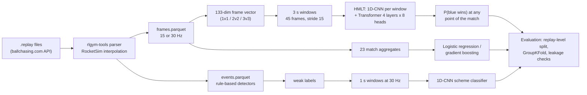

# Rocket League replay ML

Frame-level machine learning on Rocket League match replays, from my MSc dissertation.
The code turns raw `.replay` files into frame tables (one row per game tick at 15 or 30 Hz),
then asks three questions: can the winner be predicted from game physics alone, part-way
through a match? Can short "play schemes" (aerial dribble, double tap, ceiling shot) be
recognised from raw physics? Where does evaluation leak information? The aim was a method
whose numbers hold up, not the best-looking numbers.

## Pipeline



| Stage | Code |
|---|---|
| Download replays (your own API key) | `src/ingestion/ballchasing_download.py` |
| Parse `.replay` -> frame / label / event Parquet tables | `src/ingestion/replay_pipeline.py`, `src/obs/frame_features.py` |
| Rule-based detectors (weak labels) | `src/patterns/` |
| 133-dim universal frame vector, match aggregates | `src/obs/universal_frames.py`, `src/obs/match_features.py` |
| Windowing, replay-level split, caching | `src/models/dataset.py`, `src/models/frame_sequence_dataset.py` |
| Hierarchical match-level Transformer (HMLT) | `src/models/hierarchical_winning_v2.py`, `src/train_hmlt_v2.py` |
| Tabular baselines (GroupKFold by replay) | `src/validation/winpred_baselines.py` |
| Player-disjoint folds (leakage check) | `scripts/exp_player_folds.py` |
| Play-scheme windows and classifier | `src/discovery/scheme_window_extractor.py`, `src/discovery/train_scheme_hmlt.py` |
| Goal-imminence clock ablation (leakage check) | `src/eval_imminence.py`, `src/models/imminence_dataset.py` |

## Results

All numbers below are copied from the metric files in [`results/`](results/) (copies of the
original run outputs, with machine paths removed). "Physics only" means no score-derived
inputs: the model never sees the scoreboard.

**Winner prediction, physics only (ROC-AUC by fraction of the match observed)**

| Model | Data and protocol | ~1/3 | 1/2 | 3/4 | Full match |
|---|---|---|---|---|---|
| HMLT, 1,035,009 parameters | 19,826 replays, replay-level split 13,873 / 2,977 / 2,976, held-out test | **0.718** (35%) | 0.770 | 0.850 | 0.945 |
| HMLT, same architecture | 14,866 replays, split 10,411 / 2,229 / 2,226 | 0.678 (35%) | 0.722 | 0.802 | 0.887 |
| Gradient boosting (17 match aggregates) | 13,579 matches, 5-fold GroupKFold by replay | **0.713** (34%) | 0.771 | 0.845 | n/a |
| Logistic regression (same features) | same | 0.641 (34%) | 0.655 | 0.669 | n/a |

Sources: `results/winpred_hmlt_physics_15hz_20k.json`, `results/winpred_hmlt_physics_15hz_15k_curve.csv`,
`results/winpred_baselines_at34.json`, `_at50.json`, `_at75.json` (the 1/2 and 3/4 baselines use 13,582 matches).

**Play-scheme classifier (1D-CNN on raw frames, 5-fold GroupKFold by replay)**

| Setting | Windows | Macro-F1 |
|---|---|---|
| 30 Hz, 1 s windows, 4 classes | 187,707 (112,624 none, 34,652 aerial dribble, 30,607 double tap, 9,824 ceiling shot) | **0.831 ± 0.001** |
| Resolution ablation: 30 Hz, 3 s windows | 5,522 | 0.617 ± 0.011 |
| Resolution ablation: 15 Hz, 3 s windows | 5,522 (same set) | 0.298 ± 0.014 |

Per-class F1 of the main run: none 0.923, ceiling shot 0.878, double tap 0.771, aerial dribble 0.752.
Sources: `results/scheme_hmlt_30hz_1s.json`, `results/scheme_hmlt_30hz_3s.json`, `results/scheme_hmlt_15hz_3s.json`.

**Leakage checks**

| Check | Result | Source |
|---|---|---|
| HMLT at kick-off (5% of the match, score 0-0) | accuracy 0.537, ROC-AUC 0.554: close to chance, as it should be | `results/winpred_hmlt_physics_15hz_20k.json` |
| Same players in several matches: player-disjoint folds instead of replay folds | gradient boosting 0.720 -> 0.713, logistic regression 0.651 -> 0.650 | `results/player_folds.json` |
| "Goal in the next 10 s", tabular, 600-replay subset (29,517 test windows, base rate 0.209) | XGBoost PR-AUC 0.932 with the 23 aggregates, 0.307 after removing the 3 time features; logistic regression 0.883 -> 0.266 | `results/imminence_tabular_clock_ablation.json` and `.log` |

## Quickstart

```bash
python -m venv .venv && source .venv/bin/activate        # Python 3.12
pip install torch==2.12.0 --index-url https://download.pytorch.org/whl/cpu
pip install -r requirements-dev.txt
python -m pytest                                          # offline, CPU, ~15 s
```

The tests never touch real replays. `tests/conftest.py` writes a small synthetic tree of
frame / label / event tables in the same format the parser produces, and the tests run the
windowing, splits, baselines, player grouping, scheme labelling and both training entry points
on it.

## Getting data

Replays are not redistributed here. Download your own from [ballchasing.com](https://ballchasing.com)
with your own API key (Settings -> API Key on the site), passed through an environment variable:

```bash
export BALLCHASING_TOKEN=<your-api-key>
python -m src.ingestion.ballchasing_download --count 50 --playlist ranked-doubles \
    --min-rank grand-champion-1 --cache-dir data/raw
python -m src.ingestion.replay_pipeline --raw-dir data/raw --out-dir data/processed_15hz
RL_DECIMATE_EVERY=1 python -m src.ingestion.replay_pipeline --raw-dir data/raw --out-dir data/processed_30hz
```

The dissertation runs also used public replay collections from Kaggle. Respect the
ballchasing.com terms; the client is rate-limited (2 requests/s by default) and retries with back-off.

Runs behind the tables (flags taken from the result files and the scripts' docstrings; the
20k HMLT run used a large GPU with a VRAM-resident cache, peak 51.6 GB):

```bash
python -m src.train_hmlt_v2 --processed-root data/processed_15hz --limit 20000 --no-hybrid \
    --batch-size 16 --train-max-windows 384 --val-max-windows 384 --eval-lru 4000 \
    --patience 5 --frames-cache-root none --cache-device cuda --vram-cache-gb 70
python -m src.validation.winpred_baselines --processed-root data/processed_15hz --limit 15000 --at-fraction 0.34
python scripts/exp_player_folds.py --processed-root data/processed_15hz --limit 15000
python -m src.discovery.train_scheme_hmlt --processed-root data/processed_30hz --window-len 30 --stride 30 --device cuda
python -m src.eval_imminence --processed-root data/processed_15hz --limit 600 --horizon-s 10
```

## Tests and CI

`python -m pytest` runs 129 tests in about 15 seconds on a desktop CPU. GitHub Actions
(`.github/workflows/ci.yml`) runs the same command on `ubuntu-latest` with CPU-only PyTorch.

## Design decisions

- **Split by replay, never by window.** Windows of one match are highly correlated. Every split
  (train / val / test for HMLT, GroupKFold for everything else) keeps all windows of a replay
  on one side.
- **Check for leakage, don't assume it away.** Three checks: the kick-off prediction must be near
  chance; player-disjoint folds must not change the result much; the match clock must be
  ablated in goal-imminence prediction (see below).
- **Physics only as the headline.** Score-derived inputs make win prediction easy and say
  little about play. They are reported separately and excluded from the main comparison.
- **Transformer vs gradient boosting.** Aggregates throw away the order of events. The
  hierarchical model encodes every 3 s window with a small CNN, then lets a Transformer attend
  over the whole sequence, so one model predicts at any point of the match from raw frames.
  Gradient boosting on 23 hand-made aggregates is the strong baseline it has to beat.
- **One 133-dim frame layout for 1v1, 2v2 and 3v3** (six car slots plus presence masks), with a
  test that the offline vector from Parquet equals the vector built from a live game state.

## Limitations and negative results

- **The Transformer does not beat gradient boosting.** 0.718 vs 0.713 at a third of the
  match is a tie: the gap is smaller than the 0.007 that the baseline itself moves between
  replay folds and player folds, and the two are evaluated differently (one held-out test set
  vs 5-fold CV on a different sample). The baseline also gets the players' MMR, which the
  Transformer does not. My reading is a signal ceiling at this data scale, not a win.
- **More data helped the Transformer:** 0.887 -> 0.945 at full time from about 15k to 20k replays.
- **Scheme labels are weak labels.** They come from my rule-based detectors, kept only when the
  replay's touch analyzer confirms a car-ball contact. A macro-F1 of 0.831 measures how well
  the CNN recovers those labels from raw physics, not agreement with human annotators. "None"
  windows are sampled at least 1 s away from any detected event, which makes them easier than
  real negatives. The best epoch is chosen on the held-out fold, so the number is slightly optimistic.
- **0.298 at 15 Hz is not comparable to 0.831.** The fair comparison is 0.298 vs 0.617 on
  the same 5,522 windows; the 0.831 run uses 34x more data and shorter windows.
- **Flip resets could not be detected** from replay data (wheel-ball contact is not
  reconstructed faithfully), so that class was dropped. See `src/patterns/flip_reset.py`.
- **Goal imminence is mostly the clock.** The 0.932 XGBoost uses all 23 aggregates, clock
  included; dropping the three time features gives 0.307. This was measured on a 600-replay
  subset only.
- **Player folds are lopsided.** Shared players link 11,744 of the 15,000 replays into one
  group, so one fold dominates; the small delta is a sanity check, not a precise estimate.
- The results cannot be reproduced from this repo alone: you need the replays and, for the
  20k run, a large GPU.

## How this was built

The code was written with AI coding agents (Claude Code), which wrote most of it. I owned
the research questions, the architecture, the review gates and the verification. What was
checked, and how:

- **Leakage**, with the three checks above. A first tabular model (in an earlier stage of
  the project, not in this repo) scored suspiciously high; the cause was a feature computed
  from goals scored. Later results got the same treatment; that is how the clock leak in
  goal-imminence prediction was found.
- **A data bug caught and fixed:** car identities were scrambled in an early version of the
  frame tables. Results from the corrupted data were discarded and the runs repeated on
  clean tables.
- **Detectors checked against the game:** detections were watched in the Rocket League
  replay viewer to measure precision, and full matches were watched to estimate recall.
  This is how the flip-reset detector was found unreliable.
- **Offline equals live:** a unit test checks that the frame vector built from Parquet
  matches the one built from a live game state.
- **Numbers kept traceable:** every result went into a ledger with its source file. For
  this repo, every number in the tables above was rechecked against the metric files in
  `results/`, and a test asserts the logged parameter count (1,035,009).
- **Tests:** 129 offline tests on synthetic data (see above).

## License

MIT, see [LICENSE](LICENSE). Dependencies (PyTorch, scikit-learn, XGBoost, Polars, PyArrow,
rlgym, rlgym-tools, RocketSim and others) are installed from PyPI under their own licenses;
no third-party code is vendored.
